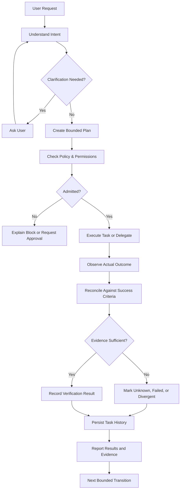

# OceanicOS: Product Vision and Architecture
## Architecture Proposal Grounded in the Repository • 21 October 2026

**Category:** The Conversational and Autonomous AI Ecosystem  
**Core Promise:** *Reality, verified.*  
**Operating Modes:** **Conversation** (thinking, discussing, creating) and **Work** (planning, delegating, executing, verifying).

---

## 1. Product Identity

**OCEANICOS**  
*The conversational and autonomous AI ecosystem.*  
*Reality, verified.*

### Product Promise
Tell OceanicOS what you want to accomplish. It understands your intent, plans the work, uses authorized capabilities, verifies what can be verified, and shows you what actually happened.

### The Differentiator
Not just an AI that can answer or act, but an AI system designed to distinguish:
$$\text{A Plausible Answer} \neq \text{A Proposed Action} \neq \text{An Executed Action} \neq \text{A Verified Outcome}$$

### The Relationship to ChatGPT and Manus

| Product | Primary Experience | OceanicOS Opportunity |
| :--- | :--- | :--- |
| **ChatGPT** | Conversation, reasoning, creation, and tools | Natural conversation, context, and flexible assistance |
| **Manus** | Delegated tasks and agent execution | Planning, monitoring, and completing multi-step work |
| **OceanicOS** | **Conversation + bounded execution + verification** | **Make evidence, authority, provenance, and honest outcomes central to the experience** |

The goal is not to copy either product. It is to make OceanicOS feel:
- As easy to talk to as ChatGPT,
- As useful for delegated work as Manus, and
- Distinctive in how it handles trust, evidence, and verifiable outcomes.

---

## 2. What Already Exists vs. What Needs to Be Built

### Implemented According to Repository Evidence
- **The MINI kernel:** `Observe → Verify → Remember`.
- **Typed contracts, observation, rule-based verification**, and append-only hash-chained memory.
- **Fastify API (`:5000`) and React/Vite web dashboard (`:3000`)** for the verification lifecycle.
- **Deep-tier CLI binary (`bin/oceanicos.mjs`) and SDK access**.
- **HMAC-SHA256 and Ed25519 attestation capabilities**.
- **Runtime event streaming (SSE), local persistence options**, and bounded local job records.
- **Verification tests and CI workflows** (950+ tests passing).

### Present, but Bounded or Incomplete
- **Attestation and action authorization:** defined capabilities, but production-grade key management and broader external authorization remain open.
- **Local job records:** exist, but are bounded local records rather than a distributed worker scheduler.
- **Persistence and event logs:** exist, but do not establish distributed cloud recovery or universal multi-region durability.
- **Web dashboard:** can inspect evidence, chat with memory, and verification events, but requires complete synthesis into a unified two-mode assistant.
- **CI and artifact publication:** do not prove live production cloud deployment.

### Proposed Product Capabilities
- **Persistent conversational assistant** with multi-turn context and streaming.
- **Planner** that converts requests into explicit goals, tasks, and acceptance criteria.
- **Autonomous orchestrator** that delegates to real workers and tracks progress.
- **Governed tool/connector registry** with capability-specific permissions.
- **Task workspace** for live execution, cancellation, recovery, and results.
- **Evidence-backed response layer** that connects claims to observations and verification records.

---

## 3. Proposed Target Architecture

The architecture has six cooperating layers, with $\Omega\infty\text{v}$ as the verification spine:

```text
┌────────────────────────────────────────────────────────┐
│ Layer 1 — Conversational Experience                    │
│ Chat, voice, file input, conversation history, streams │
└──────────────────────────┬─────────────────────────────┘
                           │
┌──────────────────────────▼─────────────────────────────┐
│ Layer 2 — Intent and Planning                          │
│ Understand intent, clarify, create plans, criteria     │
└──────────────────────────┬─────────────────────────────┘
                           │
┌──────────────────────────▼─────────────────────────────┐
│ Layer 3 — Agent Orchestration                          │
│ Select tools, assign workers, bounded tasks, recovery  │
└──────────────────────────┬─────────────────────────────┘
                           │
┌──────────────────────────▼─────────────────────────────┐
│ Layer 4 — Ω∞v Verification and Authority               │
│ Policy checks, permission gates, evidence evaluation   │
└──────────────────────────┬─────────────────────────────┘
                           │
┌──────────────────────────▼─────────────────────────────┐
│ Layer 5 — Memory and Provenance                        │
│ Conversation references, task state, KAI audit trails  │
└──────────────────────────┬─────────────────────────────┘
                           │
┌──────────────────────────▼─────────────────────────────┐
│ Layer 6 — Execution and Integrations                   │
│ Model providers, search, browser, tools, APIs, files   │
└────────────────────────────────────────────────────────┘
```

### Layer Interaction Flow
1. **Conversation is the front door:** Users should not need to understand kernels, workers, or verification packages.
2. **The planner creates a structured task:** It turns an instruction into objectives, constraints, a plan, and measurable completion criteria.
3. **The orchestrator executes only admitted work:** It tracks each step and delegates through registered capabilities.
4. **$\Omega\infty\text{v}$ governs the transition from intent to action:** It checks what is permitted, captures evidence, and evaluates the observed result.
5. **Memory preserves history:** It records what the system knew, what it attempted, and what evidence supports its conclusion.
6. **The final response reflects evidence:** It reports success, partial completion, failure, or uncertainty rather than automatically trusting an agent's self-report.

---

## 4. The Core Execution Loop



---

## 5. Autonomous Operation Without Unrestricted Authority

OceanicOS operates autonomously within defined permissions and safety limits using capability-based permissions:

| Action Class | Recommended Behavior |
| :--- | :--- |
| **Read approved sources, search, summarize, analyze** | Execute automatically within configured limits |
| **Create drafts, reports, and local task plans** | Execute automatically; preserve provenance |
| **Run code or modify files** | Use an isolated workspace with scoped permissions and recovery |
| **Send messages, publish content, or change external systems** | Require explicit authorization or a narrowly defined prior grant |
| **Spend money, transfer assets, expose secrets, destructive actions** | Require explicit approval and strong safeguards; never infer consent from a general request |
| **Encounter missing evidence, conflicting observations, expired authority** | Stop the affected transition and report the uncertainty |

*The execution service enforces these permissions independently of the language model. A system prompt telling an agent to behave safely is not an adequate security boundary.*

---

## 6. The Product Experience: Three Workspaces

The interface is conversational first, with task execution visible when work becomes complex:

### A. Chat Workspace (Conversation Mode)
Natural conversation, follow-up questions, model responses, and context-aware assistance. Simple questions feel as seamless as ChatGPT.

### B. Task Workspace (Work Mode)
When the user delegates a job, show the plan, current step, tool activity, completed work, blockers, and controls to pause or cancel.

### C. Evidence Workspace (Verification Spine)
Show source references, verification results, decision records, attestation status, and what remains unverified. Users can inspect the cryptographic proof behind every result.

---

## 7. Implementation Roadmap

```text
01 Conversational MVP
   └── Connect chat interface to model streaming, multi-turn context, error handling, evidence-aware responses.
02 Structured Planning and Task State
   └── Typed task specifications, plans, success criteria, resumable state, task history tied to KAI memory.
03 Governed Execution Engine
   └── Registered tool system, capability grants, policy evaluation, isolated execution, timeouts, budgets.
04 Agent Delegation
   └── Specialist workers (research, analysis, code, docs), bounded concurrency, idempotency, failure recovery.
05 Production Readiness & Ecosystem
   └── Hardened identity, tenant isolation, key management, backups, monitored operational health.
```

---

## 8. Recommended Repository Boundaries

| Proposed Component | Responsibility | Relationship to Existing Code |
| :--- | :--- | :--- |
| **Conversation Service** | Sessions, messages, model streaming | Active in `apps/api/src/chat-route.ts`, expand with streaming |
| **Intent/Planner Module** | Structured objectives and task plans | Wire to `@oceanicos/mini` and `packages/types` |
| **Orchestrator** | Task state, worker delegation, cancellation | Built on `apps/api/src/omega.ts` and bounded workers |
| **Tool Registry** | Discoverable, permission-scoped capabilities | Extend `@oceanicos/authorization` |
| **Policy/Admission Layer** | Authorize actions before execution | Enforce via `packages/authorization` and `mini` |
| **Evidence Response Layer** | Link results to observations and records | Reuse `@oceanicos/observer`, `verification`, `remember`, `attestation` |
| **Web Chat/Task UI** | Unified conversational and execution workspace | Unify `apps/web/src/App.tsx`, `OmegaWorkspace.tsx`, and `MaxEquationPanel.tsx` |
| **Provider Adapters** | Models, browser, search, files, external APIs | Encapsulate under `packages/inference` and tool connectors |

---

## 9. Success Metrics

1. **Conversation Quality:** Useful assistance, low latency, clear clarification requests.
2. **Task Completion:** Percentage of tasks satisfying predefined acceptance criteria.
3. **Evidence Quality:** Percentage of claims with traceable supporting evidence.
4. **Honest Reporting:** Clear distinction between completed execution and unverified claims.
5. **Safety:** Zero unauthorized actions, strict fail-closed enforcement on sensitive actions.
6. **Reliability:** Idempotent retries, zero duplicate external actions, clean cancellation handling.
7. **User Control:** Ability to inspect, pause, cancel, and understand autonomous work at all times.

---

## 10. Summary Recommendation

Build OceanicOS as **one assistant with two operating modes**:
- **Conversation:** Thinking, learning, discussing, and creating.
- **Work:** Planning, delegating, executing, and verifying.

Both modes share the same identity, policy, memory, and evidence foundations. Keep $\Omega\infty\text{v}$ as the trust spine, preserving the core invariant:
$$\Omega\infty\text{v} ::= \operatorname{VERIFY}(\Delta\text{REALITY})$$
